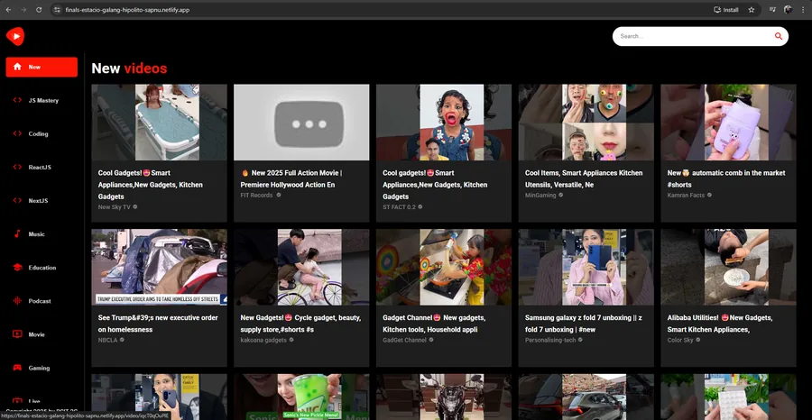

# YouTube Clone

A YouTube-style browsing experience built in React: search, a category
sidebar, video playback, channel pages and related videos. The data comes from
the YouTube v3 API through RapidAPI, and the UI is Material UI.

**[▶ Live demo](https://youtube-clone-by-dei.netlify.app/)**



## Running it locally

You need Node 18+ and a RapidAPI key for the
[YouTube v3](https://rapidapi.com/ytdlfree/api/youtube-v31) API.

```bash
git clone https://github.com/adrielleestacio/Youtube-API.git
cd Youtube-API
npm install
cp .env.example .env
```

Put your key in `.env`:

```
REACT_APP_RAPID_API_KEY=your-key-here
```

Then start it:

```bash
npm start
```

The app opens at <http://localhost:3000>.

> Create React App inlines every `REACT_APP_*` variable into the JavaScript
> bundle at build time, so this key is visible to anyone who opens the
> deployed site. Use a key with a quota you are happy to expose, and keep it
> separate from any key that bills you.

## How it is put together

| Path | What it does |
| --- | --- |
| `src/utils/fetchFromAPI.js` | The single place the API is called. Everything else asks for a path and gets data back. |
| `src/utils/constants.js` | The sidebar categories and their icons. |
| `src/components/Feed.jsx` | The home page: category sidebar plus the selected category's videos. |
| `src/components/SearchFeed.jsx` | Results for a search term from the URL. |
| `src/components/VideoDetail.jsx` | A single video — player, title, channel, stats and related videos. |
| `src/components/ChannelDetail.jsx` | A channel's banner, avatar and uploads. |
| `src/components/Videos.jsx` | Renders a mixed list of video and channel results. |

Routing is `react-router-dom`; playback is `react-player`, which handles the
embed rather than hand-rolling an iframe.

## Built with

React · Material UI · React Router · Axios · react-player · RapidAPI (YouTube
v3) · Netlify
